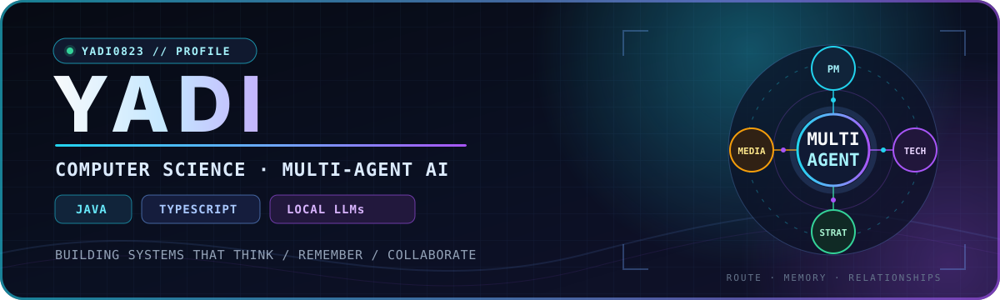
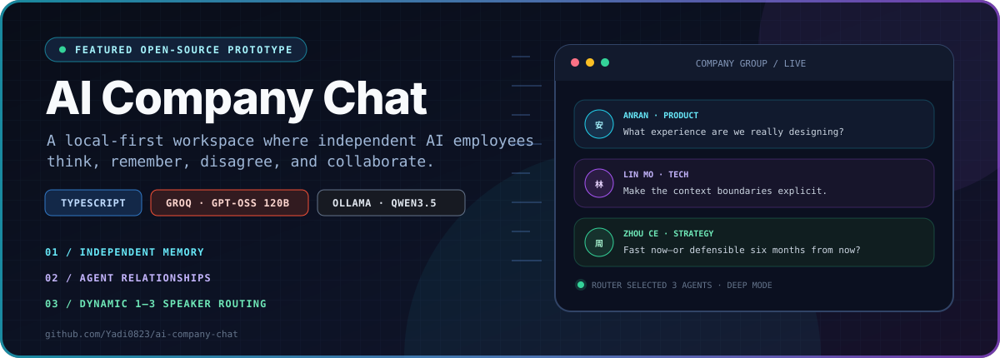
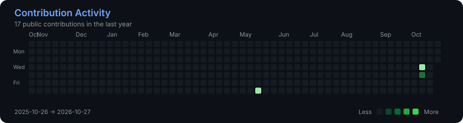

 

`Building things that think, remember and collaborate.`

**Computer Science @ Victoria University of Wellington** · **Java / TypeScript / AI Agents**

 

## 01 // About

- 🎓 Computer Science student at **Victoria University of Wellington**
- 🤖 Exploring **AI agents, local LLMs, memory systems, and multi-agent orchestration**
- ⚡ Building with **Java, TypeScript, React, Groq, and Ollama**
- 🧠 Turning model calls into systems that can **route, remember, disagree, and collaborate**

## 02 // Toolkit

 

&nbsp;&nbsp;

&nbsp;&nbsp;

&nbsp;&nbsp;

&nbsp;&nbsp;

&nbsp;&nbsp;

&nbsp;&nbsp;

## 03 // Featured Build

 

<a href="https://github.com/Yadi0823/ai-company-chat"><strong>View Repository →</strong></a>
&nbsp;·&nbsp;
<a href="https://github.com/Yadi0823/ai-company-chat#architecture">Architecture</a>
&nbsp;·&nbsp;
<a href="https://github.com/Yadi0823/ai-company-chat#getting-started">Run Locally</a>

  

- Four independent agents with distinct personalities, private memory, and relationship state
- Dynamic **1–3 speaker routing** for group chat, plus private chat and bounded agent-to-agent discussion
- Switchable **Groq Cloud / GPT-OSS 120B** and **Ollama Local / qwen3.5:4b** providers
- Fast/Deep response strategies with rate-limit-aware scheduling and token budgeting

### Now building

- More natural disagreement and collaboration inside **AI Company Chat**
- More efficient Groq/Ollama orchestration without flattening the multi-agent experience
- Better memory retrieval and context selection for long-running conversations

## 04 // GitHub in Motion

 

 

Language cards describe public repository composition—not proficiency.

### 🐍 Contributions, animated

<picture>
  <source media="(prefers-color-scheme: dark)" srcset="https://raw.githubusercontent.com/Yadi0823/Yadi0823/output/github-contribution-grid-snake-dark.svg" />
  <source media="(prefers-color-scheme: light)" srcset="https://raw.githubusercontent.com/Yadi0823/Yadi0823/output/github-contribution-grid-snake.svg" />
  
</picture>

---

## 05 // Currently Learning

- ☕ **Java data structures & algorithms** — building strong foundations
- 🧭 **Multi-agent orchestration** — routing, memory, and relationships
- 🦙 **Local LLM systems** — inference, evaluation, and trade-offs
- 🧩 **Context-efficient prompting** — retrieval instead of prompt bloat

## 06 // Connect

  

**Thanks for stopping by — build something interesting. ⚡**

